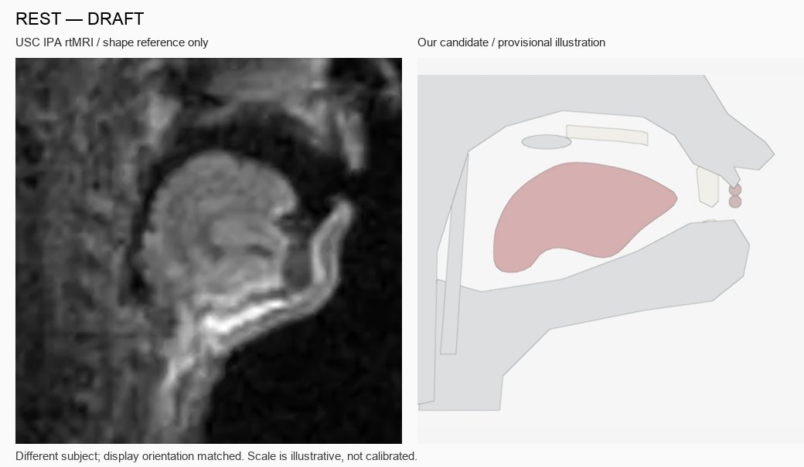
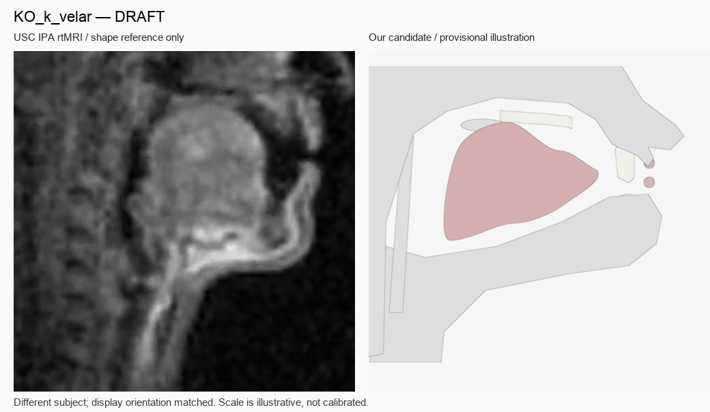
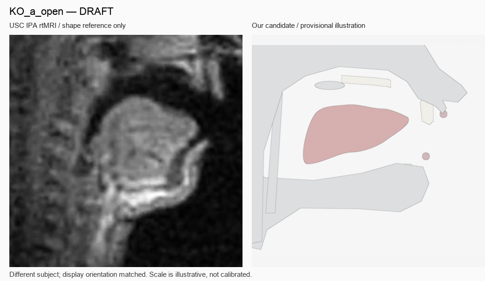
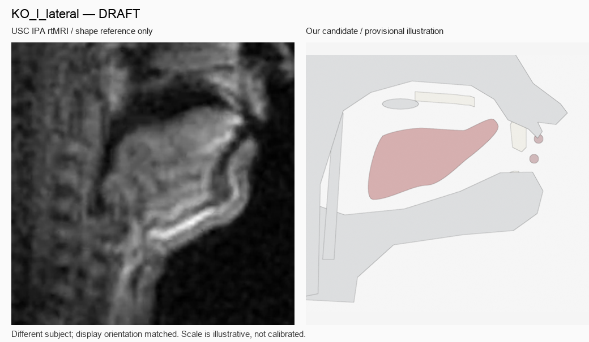
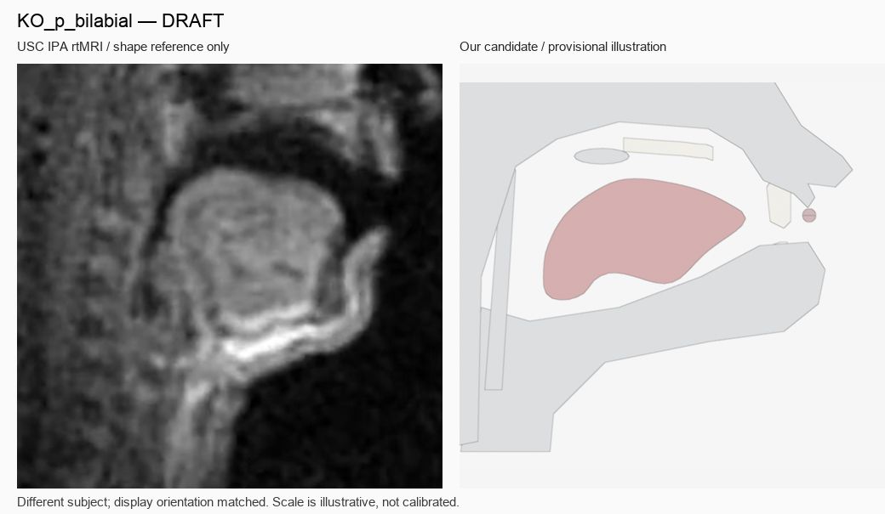
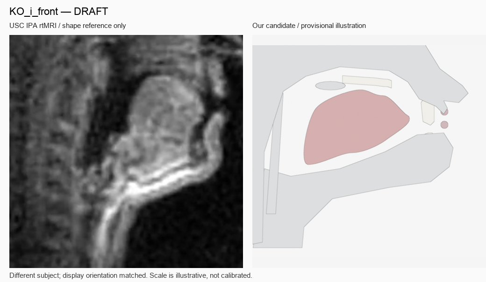

# KOREAN_PRONUNCIATION_SHORTS
# PHASE 2 — ARCHITECTURE / VISEME REVIEW PACKAGE

## 1. WHY THIS REVIEW EXISTS

We are following the fixed MASTER_IMPLEMENTATION_SPEC to build a sagittal viseme puppet system.

PHASE 1 completed the reusable Blender mesh + Shape Keys puppet structure. PHASE 2 is drafting REST plus five phoneme visemes. This review asks whether the current implementation matches the clean-slate architecture the lead architect intended. It is not a request for cosmetic edits. Please inspect the six attached images and make an architecture-level decision.

The user wants a direct reassessment of whether the current method is sound, whether the placeholder anatomy blocks meaningful viseme approval, and what the exact next action should be. Do not defend prior work just because it exists.

## 2. MASTER SPEC

Fixed source of truth: [MASTER_IMPLEMENTATION_SPEC.md at commit 74b5a011a7c5238fb2146310d48dd7b8ca29009c](https://github.com/trustlj-cpu/galbi-f-package/blob/74b5a011a7c5238fb2146310d48dd7b8ca29009c/MASTER_IMPLEMENTATION_SPEC.md)

Raw: https://raw.githubusercontent.com/trustlj-cpu/galbi-f-package/74b5a011a7c5238fb2146310d48dd7b8ca29009c/MASTER_IMPLEMENTATION_SPEC.md

## 3. PHASE 1 SUMMARY

- Blender 5.2.2.
- Blender mesh + Shape Keys.
- Tongue: 128 vertices.
- Upper/lower lips: 24 vertices each.
- Velum: 16 vertices.
- Deterministic and save/reopen verification passed.
- PHASE 1 structure was approved by the user as reusable structure, not as final visual style.
- The six visemes are still drafts; no phoneme has been validated.
- Head/anatomy display elements including the head silhouette, displayed teeth, velum, and pharynx wall remain placeholders (PLACEHOLDER_VISUAL_ONLY). They are not source anatomy or subject-specific measurements.

## 4. PHASE 2 METHOD

Current method:

- Reusable phoneme-level viseme library.
- Same 128-point tongue topology across all six shapes.
- Blender Shape Keys.
- MRI / IPA materials are SHAPE_REFERENCE_ONLY.
- No custom physics.
- No generative articulation.
- No word-specific manual animation.
- Actual audio timing is intended to enter later through alignment.
- Coarticulation is deferred to a later phase.

Current library:

- REST
- KO_k_velar
- KO_a_open
- KO_l_lateral
- KO_p_bilabial
- KO_i_front

## 5. CURRENT SIX DRAFTS

Images are existing approval sheets copied byte-for-byte from the project. Each sheet places its reference on the left and the provisional puppet candidate on the right.

### REST

Source asset: SYSTEM/PHONEME_LIBRARY/visemes/REST.png

AUTO:
- 128 points.
- Self-intersection: 0.
- Palate penetration: 0.
- Area difference from REST: 0%.
- Status: DRAFT.

### KO_k_velar

Source asset: SYSTEM/PHONEME_LIBRARY/visemes/KO_k_velar.png

AUTO:
- Posterior elevation candidate.
- Posterior functional-palate proxy gap: 0.111 mm.
- Area difference: +14.35%.
- True soft-palate contact is not measured or validated; current contact geometry is only a provisional proxy.
- Status: DRAFT.

### KO_a_open

Source asset: SYSTEM/PHONEME_LIBRARY/visemes/KO_a_open.png

AUTO:
- Low/open tongue candidate.
- Jaw target: 12°.
- Minimum gap to retained functional palate: 11.12 mm.
- Area difference: −12.88%.
- Status: DRAFT.

### KO_l_lateral

Source asset: SYSTEM/PHONEME_LIBRARY/visemes/KO_l_lateral.png

AUTO:
- Alveolar tip-contact error: approximately 0 mm.
- Area difference: −15.93%, outside the ±15% reference guideline.
- A midsagittal image cannot show lateral airflow channels.
- The anterior tongue looks potentially too thin or pointed and needs human review.
- Status: DRAFT.

### KO_p_bilabial

Source asset: SYSTEM/PHONEME_LIBRARY/visemes/KO_p_bilabial.png

AUTO:
- Tongue shape is an exact copy of REST.
- Bilabial lip closure target: 0 mm.
- Tongue dominance: 0.2.
- Lip dominance: 1.0.
- Status: DRAFT.

### KO_i_front

Source asset: SYSTEM/PHONEME_LIBRARY/visemes/KO_i_front.png

AUTO:
- Anterior/high tongue candidate.
- Anterior hard-palate gap: 2.783 mm.
- Area difference: +8.56%.
- A shallow upper contour dip remains under review.
- Status: DRAFT.

## 6. REFERENCE MATERIAL

- USC rtMRI IPA chart / Patricia Keating: https://sail.usc.edu/span/rtmri_ipa/pk_2015.html
- USC paper: https://sail.usc.edu/span/pdfs/toutios2016illustrating.pdf
- Official IPA chart: https://www.internationalphoneticassociation.org/content/ipa-chart
- Existing provisional static anatomy in the project.

Honesty constraints:

- The reference speaker and our puppet are different people.
- The images are not scale-calibrated to the puppet.
- They are not MRI measurements of a Korean speaker.
- The MRI is used as SHAPE_REFERENCE_ONLY.
- The result remains an educational illustration, not a measured anatomical model.

## 7. CURRENT UNRESOLVED ISSUES

1. KO_l area is −15.93%, beyond the ±15% guideline.
2. KO_l visual: the anterior tongue may look too thin or pointed.
3. KO_k has no true velum geometry; current 0.111 mm is a proxy gap only.
4. Jaw sign convention: SPEC says +Z opening; legacy transformed data currently produces −Z opening. Runtime canonical rule is unresolved.
5. Tongue index segmentation: shapes share 128-point correspondence, but the nominal SPEC tip/dorsum/root index ranges are not verified as matching the anatomy.
6. PHASE 1 velum, pharynx, and some head display geometry are PLACEHOLDER_VISUAL_ONLY.

## 8. IMPORTANT QUESTIONS TO CLAUDE

This is not a request like “make the /l/ 2 mm thicker.” Please judge the architecture.

A. Is the current PHASE 2 method — Blender mesh + Shape Keys, same-topology 128-point tongue, phoneme viseme library, MRI/phonetic references, later audio alignment, later coarticulation — aligned with the intent of the MASTER_IMPLEMENTATION_SPEC? Answer YES / NO / CHANGE REQUIRED.

B. After inspecting the six drafts, is the viseme construction method itself correct? Is placing an abstract sagittal puppet shape beside MRI and approving phoneme keys the right production method?

C. Does the candidate image on the right merely look stylistically rough, or is shape construction itself going wrong?

D. The MASTER SPEC says Codex makes a first draft and a person approves it. Is using the existing 15_GP seed, comparing it against MRI, and revising it appropriate, or should canonical visemes have been constructed from MRI/phonetic references from the beginning?

E. For each image, choose KEEP / REVISE / REBUILD and explain briefly:
- REST
- /k/
- /a/
- /l/
- /b/
- /i/

F. Must the KO_l −15.93% area deviation be corrected? Is ±15% merely a guideline? Which takes priority: shape naturalness or the area target?

G. Is it appropriate to create a provisional velar reference target for KO_k, or should PHASE 2 drop contact-mm validation and use only visual place/manner approval?

H. Should the 128-point anatomical index segmentation be canonicalized now in PHASE 2, or is shared topology correspondence enough for production?

I. Do the current head/palate/teeth/velum placeholder qualities interfere with viseme approval? Should a better anatomy puppet be built before PHASE 2?

J. Most important: having seen these six images, would you still choose this architecture? If starting clean today with these images, which next step should be taken?
1. Continue current method and fix a few keys.
2. Change the viseme construction method.
3. Rebuild puppet anatomy first.
4. Change representation.

## 9. REQUIRED CLAUDE ANSWER FORMAT

[ARCHITECTURE VERDICT]
KEEP / CHANGE / STOP

[CURRENT IMPLEMENTATION VERDICT]
Is the implementation correct so far?

[IMAGE-BY-IMAGE]
REST: KEEP / REVISE / REBUILD
K: KEEP / REVISE / REBUILD
A: KEEP / REVISE / REBUILD
L: KEEP / REVISE / REBUILD
B: KEEP / REVISE / REBUILD
I: KEEP / REVISE / REBUILD

[PHASE 2 BLOCKERS]
Only actual blockers.

[WHAT NOT TO FIX]
Items that should not be touched now.

[NEXT EXACT ACTION]
Exactly one next action.

[SPEC REVISION]
Does MASTER_IMPLEMENTATION_SPEC need changes: YES / NO.
If YES, identify the section and the proposed change.

## 10. PUBLIC LINKS

Publish the review package in a new commit in trustlj-cpu/galbi-f-package. Do not change the fixed MASTER_IMPLEMENTATION_SPEC commit. Use the package commit SHA, not a branch-head URL, for the review links.

Required after publication:

1. GitHub blob markdown URL at fixed commit.
2. Raw markdown URL at fixed commit.
3. Raw URL for each of the six PNGs.
4. PDF raw URL if a PDF was created.

Recommended single link for Claude review: PHASE2_REVIEW_PACKAGE.md at the new commit.

## 11. PROJECT FILES

Project-relative source paths are listed above. The original project assets are not included beyond the six existing approval PNGs. No original project file should be modified.
